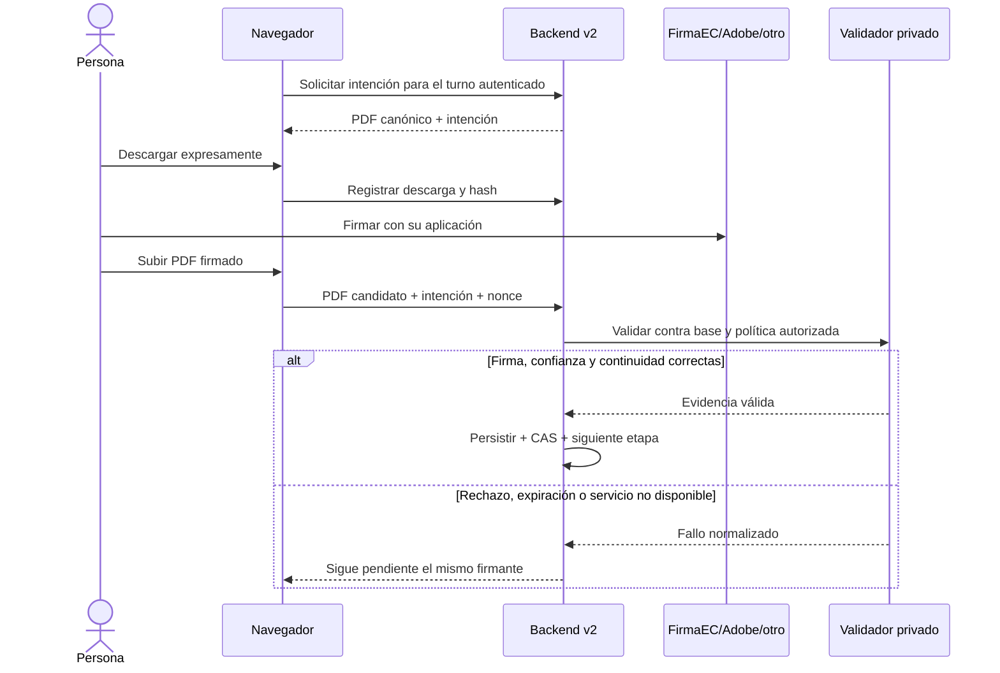

# ADR-001 — Firma criptográfica de LeapSign Firmador v2

Estado: base implementada; producto y publicación bloqueados. 19-10-2026.

## Contexto y decisión

V1 coordina PDF externos, pero no valida CMS. V2 requiere validación independiente
antes de avanzar. No se reutilizan los permisos, el backend desplegado ni las
reglas operativas de v1 para declarar una firma válida. El esquema `signing_v2`
se prepara fuera del sistema de migraciones automático de v1.

Antes de emitir la primera intención, un PDF **sin firmas** se prepara como base
canónica con AcroForm/SigFlags para poder comparar estrictamente los cambios de
la primera firma. La preparación es incremental: conserva el PDF original como
prefijo; se registra el hash de la base preparada, distinta del archivo de entrada.
Un PDF ya firmado se devuelve byte por byte sin reescribirlo. No se prepara ni
normaliza el documento después de emitir una intención. La comparación de revisiones
rechaza contenido de páginas sustituido y cambios de campos ajenos a la firma.

### Clave privada local

La futura implementación directa debe ejecutarse en un Web Worker propio, con
dependencias fijadas, sin conexiones, almacenamiento ni trazas. El navegador
principal sólo enviará al worker el PDF, el contenedor y la contraseña en memoria;
el backend recibirá exclusivamente PDF firmado e identificador/nonce de intención.
Cancelar, finalizar, vencer el tiempo o cerrar el diálogo debe terminar el worker
y limpiar los controles DOM/referencias. No se recordará certificado ni contraseña.
JavaScript no garantiza el borrado físico inmediato de memoria, cadenas ni copias
internas gestionadas por el recolector de basura. No se prometerá zeroización.

**No implementado aún:** lectura P12/PFX, modal, worker y firma directa.
`@libpdf/core@0.5.3` se evaluó fuera de la aplicación. Su motor usa PAdES incremental,
pero fuerza firma invisible: no cumple la apariencia obligatoria. El cambio técnico
mínimo propuesto es un motor/revisión que exponga explícitamente posición y flujo
de apariencia antes de firmar, sin reescribir PDF ya firmados ni reconstruir CMS
manualmente. Cualquier adaptación debe conservar la licencia MIT y superar los
tests de ByteRange, dos/tres firmas, DocMDP y pruebas reales de interoperabilidad.
No se mueve la clave al servidor como alternativa.

### Apariencia QR y FirmaEC

Se definen los tres perfiles solicitados en los contratos. **Ninguno se declara
compatible o implementado todavía**. La referencia visual se estudiará cuando
sea accesible el repositorio y se comprueben sus licencias archivo por archivo.
No copiar iText/código GPL/AGPL ni usar marcas institucionales sin esa revisión.
El futuro QR contendrá un identificador de auditoría, nunca secretos, PIN, nonce
de acceso ni un enlace público que revele identidades. Posición última página,
coordenadas en puntos PDF, tamaño y rotación deben mostrarse en la vista previa
y autorizarse en servidor. El sello visual no equivale a validación criptográfica.

El validador actual comprueba posición y presencia de `/AP`; **no inspecciona
semánticamente el contenido QR**. Por ello el flag del perfil sigue apagado.
Las rotaciones y formatos de página requieren fixtures adicionales antes de
aprobar el renderizador. Metadato requerido del futuro motor:
`LeapSign Firmador v2 — PAdES compatible`, nunca autor/productor oficial FirmaEC.

### PAdES y flujo externo

Alcance confirmado por el propietario: entidades de certificación de cualquier
país, incluidos Ecuador y España. No se filtra por país ni se limita a una entidad
específica. Esto no autoriza a tratar como confiable cualquier certificado raíz
autofirmado adjunto al PDF. La confianza debe proceder de un catálogo mantenido
de autoridades aprobadas para firmas de documentos, con intermediarias y
revocación verificables. Un catálogo de raíces TLS no debe confundirse con una
lista universal de prestadores de firma cualificada. En pruebas se generan CA
independientes con país EC y ES y se repite la verificación con ambas.

Implementado en `validator/v2_engine.py`: parsing estricto, base SHA-256,
continuidad incremental exacta, una sola firma nueva, CMS, cobertura completa,
firmas anteriores, cambios de formulario permitidos, certificados, confianza y
revocación. Admitidos `ETSI.CAdES.detached` y `adbe.pkcs7.detached` como entrada
externa; aceptar el segundo no lo convierte automáticamente en PAdES.
No aceptar el resultado de una comprobación del navegador como prueba.

La política inicial es conservadora: validez en la hora del servidor al recibir
la entrega. No confiar en la fecha declarada por el equipo del firmante ni afirmar
tiempo cualificado. Una firma históricamente válida con certificado hoy vencido
se rechaza; admitir LTV/TSA requiere otra política explícita y fixtures.
No se reconoce validez jurídica por el simple hecho de validar matemáticamente.

No hay AIA/OCSP/CRL remoto desde certificados: se usan raíces y evidencias de
revocación aprobadas y actualizadas fuera de la petición. Revocación obligatoria,
`allow_fetching=False`. Si la evidencia está ausente, vencida o no verifica,
rechazar. Esto evita SSRF pero exige una tarea operativa de actualización de CRL
y OCSP con destinos aprobados, tiempos y cuotas; dicha tarea aún no está conectada.

### Secuencia, intención y persistencia

Intención de 5 minutos vinculada a documento, revisión, hash, etapa, usuario
autenticado, rol, perfil, posición, nonce y correlation ID. La base no almacena
el nonce en claro. La RPC privada serializa por documento y hace compare-and-swap
de la versión antes de aceptar; un fallo nunca completa una etapa. La misma
entrega aceptada puede devolver su recibo idempotente, no crear otra firma.
Una intención rechazada no se reutiliza: se emite otra para la misma etapa.
Sin más firmantes, se pasa a `final_review`, no se suplanta la aprobación final
del propietario. Las versiones no se actualizan en sitio.

Se implementaron los contratos y la migración aislada, **no** el adaptador de
persistencia/Storage de producción ni endpoints públicos. Ese adaptador debe:
autenticar al firmante; tomar cuotas económicas atómicas; obtener el PDF canónico;
reservar y almacenar bytes inmutables tras validar; confirmar en transacción;
gestionar huérfanos sin borrar archivos válidos y respetar 48 h/5 días de retención.
No publicar el esquema por PostgREST ni dar permisos a anon/authenticated.

### AGPLv3 y dependencias

El código original del proyecto se prepara bajo `AGPL-3.0-only`, conforme a la
solicitud. `LICENSE` conserva el texto completo y `NOTICE` identifica a Pablo
Martínez / PSMM. Terceros conservan sus licencias; no se relicencian PDF de usuarios.
Antes de ofrecer v2 por red hay que enlazar el código fuente exacto desplegado.
No hay código incorporado de FirmaEC, iText ni proveedor de pago.

Inventario Python reproducible en `python-inventory.json`, con versión,
licencia declarada y hash de METADATA; no equivale a una auditoría de seguridad
completa de todas las dependencias transitivas. pyHanko y certvalidator: MIT;
FastAPI: MIT; Uvicorn: BSD-3-Clause; cryptography: Apache-2.0 OR BSD-3-Clause;
asn1crypto: MIT. ReportLab se usa sólo para generar PDF sintéticos en tests (BSD).
PGlite 0.3.14 (Apache-2.0) sólo se instala en el entorno de pruebas, no en la app.
Las dependencias JS de v1 no se han cambiado.

## Secuencia directa prevista (NO activada)

```mermaid
sequenceDiagram
  actor Persona
  participant UI as Navegador
  participant Worker as Worker local
  participant API as Backend v2
  participant V as Validador privado
  Persona->>UI: Abrir turno autenticado y vista previa
  UI->>API: Preparar intención para versión canónica
  API-->>UI: Intención corta + PDF + hash autorizados
  Persona->>Worker: P12/PFX y contraseña, sólo en memoria
  Worker-->>UI: Datos públicos del certificado para confirmar
  Persona->>Worker: Confirmar firma local
  Worker-->>UI: PDF firmado incrementalmente
  UI->>API: PDF + intención + nonce, nunca certificado privado
  API->>V: Base canónica + PDF candidato + política
  V-->>API: Evidencia criptográfica normalizada
  API->>API: CAS de revisión + consumir intención + auditoría
  API-->>UI: Aceptado; siguiente firmante habilitado
```

## Secuencia externa prevista


